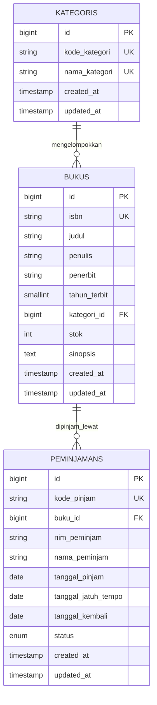

# SIPUS-Del (Sistem Informasi Perpustakaan Kampus Del)

Aplikasi web katalog dan sirkulasi peminjaman buku perpustakaan Institut Teknologi Del berbasis *server-side rendering* dengan arsitektur **Model-View-Controller (MVC)** menggunakan framework **Laravel 13** dan basis data relasional **SQLite**.

Repositori ini merupakan implementasi lanjutan praktikum **Minggu ke-6** untuk mata kuliah **Pemrograman dan Pengujian Aplikasi Web (12S3101)**, yang mencakup konektivitas database persisten, transaksi basis data ACID (*pessimistic concurrency locking* via `DB::transaction` dan `lockForUpdate`), rekapitulasi statistik menggunakan Fluent Query Builder (`DB::table`), serta manajemen sesi dan autentikasi pustakawan yang aman (*anti-session fixation* dan audit *cookie*).

---

## 1. Kredensial Akun Uji Pustakawan

Sesuai dengan ketentuan modul praktikum, sistem telah dilengkapi dengan seeder akun pustakawan baku untuk keperluan evaluasi dan pengujian otentikasi:

| Peran | Alamat Email | Kata Sandi | Status Akses |
| :--- | :--- | :--- | :--- |
| **Pustakawan Del** | `pustakawan@del.ac.id` | `password123` | Kelola Buku, Kategori, & Transaksi Sirkulasi |

---

## 2. Panduan Instalasi dan Menjalankan Proyek

Pastikan lingkungan lokal telah terpasang **PHP 8.2+** / **8.3+**, **Composer**, dan **Node.js**:

1. **Clone Repositori dan Masuk ke Direktori:**
   ```bash
   git clone -b week6-db-session https://github.com/boyharendy/-ppw-2026-week5-12S24016.git SIPUS-Del
   cd SIPUS-Del
   ```

2. **Instal Dependensi PHP dan Node.js:**
   ```bash
   composer install
   npm install
   ```

3. **Salin Environment dan Generate Application Key:**
   ```bash
   cp .env.example .env
   php artisan key:generate
   ```

4. **Migrasi dan Seeding Basis Data (Akun Pustakawan, Buku, & Transaksi Sirkulasi):**
   ```bash
   php artisan migrate:fresh --seed
   ```

5. **Kompilasi Aset Frontend (Tailwind CSS 4 via Vite):**
   ```bash
   npm run build
   ```

6. **Jalankan Server Lokal:**
   ```bash
   php artisan serve
   ```
   Buka peramban (*browser*) dan arahkan ke `http://127.0.0.1:8000`.

---

## 3. Skema Basis Data & Relasi Entitas (ERD)

Struktur tabel relasional pada sistem ini menghubungkan tiga entitas utama:
- **`kategoris`** — Pengelompokan bidang ilmu buku (`id`, `kode_kategori`, `nama_kategori`).
- **`bukus`** — Entri koleksi perpustakaan dengan relasi *One-to-Many* ke `kategoris` (`kategori_id` dengan `restrictOnDelete`) serta relasi *One-to-Many* ke `peminjamans`.
- **`peminjamans`** — Rekaman sirkulasi peminjaman buku dengan *Foreign Key* `buku_id` terikat ke `bukus.id` dengan batasan `cascadeOnDelete`.



---

## 4. Bukti Implementasi Transaksi Basis Data ACID & Concurrency Locking

Untuk mencegah masalah *Race Condition* saat beberapa pengguna meminjam buku pada milidetik yang sama ketika stok tersisa 1, sistem menerapkan transaksi basis data berprinsip **ACID** dengan **Pessimistic Row-Level Locking** (`lockForUpdate`):

### 4.1. Alur Transaksi Peminjaman Buku (`PeminjamanController::store`)
```php
DB::transaction(function () use ($validated) {
    // 1. Kunci baris buku secara eksklusif (SELECT ... FOR UPDATE)
    $buku = Buku::where('id', $validated['buku_id'])->lockForUpdate()->firstOrFail();

    // 2. Pemeriksaan stok atomik (Rollback otomatis jika stok < 1)
    if ($buku->stok < 1) {
        throw new \RuntimeException("Stok buku '{$buku->judul}' telah habis!");
    }

    // 3. Validasi pencegahan pinjam ganda untuk NIM yang sama
    $sedangDipinjam = Peminjaman::where('buku_id', $buku->id)
        ->where('nim_peminjam', $validated['nim_peminjam'])
        ->where('status', 'dipinjam')
        ->exists();

    if ($sedangDipinjam) {
        throw new \RuntimeException("Mahasiswa dengan NIM {$validated['nim_peminjam']} masih meminjam buku ini!");
    }

    // 4. Dekremen stok buku secara atomik
    $buku->decrement('stok');

    // 5. Catat transaksi peminjaman
    Peminjaman::create([
        'kode_pinjam'         => 'PINJ-' . date('Ymd') . '-' . strtoupper(Str::random(5)),
        'buku_id'             => $buku->id,
        'nim_peminjam'        => strtoupper(trim($validated['nim_peminjam'])),
        'nama_peminjam'       => $validated['nama_peminjam'],
        'tanggal_pinjam'      => $validated['tanggal_pinjam'],
        'tanggal_jatuh_tempo' => $validated['tanggal_jatuh_tempo'],
        'status'              => 'dipinjam',
    ]);
}, 3);
```

### 4.2. Bukti Pengujian Kasus Transaksi ACID:
1. **Peminjaman Berhasil (Stok Tersedia):** Stok buku berkurang 1 secara instan (`$buku->decrement('stok')`), kode pinjam unik dibuat, dan rekaman peminjaman tersimpan di database dengan status `dipinjam`.
2. **Penolakan Saat Stok = 0 (Buku Uji `9786020332901`):** Saat pengguna mencoba meminjam buku yang stoknya `0`, `RuntimeException` dilempar, transaksi di-rollback secara penuh, stok tetap `0`, dan sistem memunculkan *flash alert error* berbahasa Indonesia: `Stok buku '...' telah habis!`.
3. **Pencegahan Pinjam Ganda:** Jika NIM yang sama mencoba meminjam buku yang sama sebelum mengembalikan pinjaman sebelumnya, sistem menolak transaksi secara atomik dan menampilkan pesan galat.
4. **Pengembalian Buku:** Dibungkus dalam `DB::transaction` + `lockForUpdate()`, mengubah status menjadi `dikembalikan`, mencatat `tanggal_kembali`, serta menginkremen stok buku (`$buku->increment('stok')`).

---

## 5. Bukti Manajemen Sesi Pengguna & Audit DevTools Cookie

### 5.1. Mekanisme Keamanan Sesi Server (`AuthController`)
- **Regenerasi ID Sesi Anti-Session Fixation:** Saat login berhasil, sistem memanggil `$request->session()->regenerate()` untuk mengubah session identifier sehingga sesi sebelum login tidak dapat dibajak.
- **Pembersihan Sesi Total Saat Logout:** Memanggil `Auth::logout()`, `$request->session()->invalidate()`, dan `$request->session()->regenerateToken()` untuk menghapus seluruh data sesi di server dan me-refresh CSRF token.
- **Proteksi Rute Mutasi:** Seluruh rute penambahan, pengubahan, penghapusan buku/kategori, serta peminjaman dan pengembalian diproteksi dengan `middleware('auth')`. Pengunjung biasa hanya memiliki hak akses baca (*read-only*).

### 5.2. Audit HTTP Cookie & Atribut Keamanan (Browser DevTools)
Sistem menyimpan *email* pengguna terakhir yang login menggunakan `Cookie::queue('del_last_user_email', $request->email, 10080)`:

| Nama Cookie | Domain / Path | Atribut HttpOnly | Atribut Secure | SameSite | Kegunaan |
| :--- | :--- | :---: | :---: | :---: | :--- |
| `laravel_session` | `127.0.0.1` / `/` | **Ya (Centang Aktif)** | Sesuai HTTPS | `Lax` | ID sesi terenkripsi sisi server; terlindung mutlak dari pencurian via script XSS. |
| `XSRF-TOKEN` | `127.0.0.1` / `/` | Tidak | Sesuai HTTPS | `Lax` | Token verifikasi permintaan anti CSRF. |
| `del_last_user_email` | `127.0.0.1` / `/` | **Ya (Centang Aktif)** | Sesuai HTTPS | `Lax` | Cookie persistensi *email* pustakawan untuk auto-fill formulir login berikutnya. |

---

## 6. Rekapitulasi Statistik Query Builder & Eliminasi N+1 Query

### 6.1. Kartu Statistik Perpustakaan via Fluent Query Builder (`DB::table`)
Pada halaman muka katalog `/buku`, statistik dihitung secara optimal tanpa instansiasi Model overhead:
```php
$stats = [
    'total_judul'    => DB::table('bukus')->count(),
    'total_stok'     => (int) DB::table('bukus')->sum('stok'),
    'total_dipinjam' => DB::table('peminjamans')->where('status', 'dipinjam')->count(),
    'total_kembali'  => DB::table('peminjamans')->where('status', 'dikembalikan')->count(),
];
```

### 6.2. Agregasi Relasi `withCount('peminjamans')` & Filter Dinamis
Daftar buku mengambil relasi kategori dan jumlah peminjaman sekaligus bebas dari masalah *N+1 Query*:
```php
$bukus = Buku::with('kategori')
    ->withCount('peminjamans')
    ->when($request->search, function ($q, $search) {
        $q->where(function ($sub) use ($search) {
            $sub->where('judul', 'like', "%{$search}%")
                ->orWhere('penulis', 'like', "%{$search}%")
                ->orWhere('isbn', 'like', "%{$search}%");
        });
    })
    ->when($request->kategori_id, fn($q, $katId) => $q->where('kategori_id', $katId))
    ->orderBy('judul')
    ->paginate(10)
    ->withQueryString();
```

---

## 7. Bukti Riwayat Git & Conventional Commits Minggu 6

Proyek ini dikembangkan pada branch `week6-db-session` dengan urutan commit terstandarisasi:

1. `feat(migration): create peminjamans table with foreign key to bukus`
2. `feat(transaction): implement ACID book borrowing and return with lockForUpdate`
3. `feat(query-builder): add library analytics dashboard and dynamic search`
4. `feat(auth-session): implement librarian login, session regeneration, and cookies`
